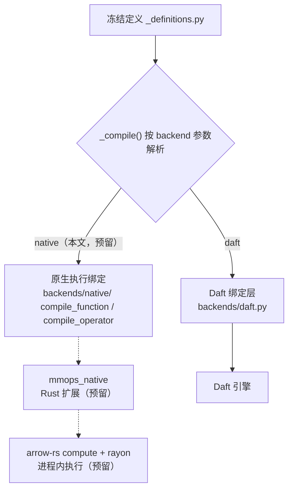

# 原生执行内核（arrow-rs 路径）设计稿 — Native In-Process Kernel Design Draft

状态：**设计稿（对比用，未实现、不承诺）**。本文仅用于评估 `backends/native.py` 接缝的启动路径，并与 Daft 路径做决策对比；对外能力承诺以 [README.md](../README.md) 为准，当前 1.x 仅支持 Daft 执行。

## 1. 定位与背景

- 本文回答一个问题：如果把 `_compile()` 的 import 目标从 `backends/daft.py` 切换到自研进程内执行内核，架构上需要什么、成本在哪里、什么条件下值得启动。
- 这是语言选型讨论中的唯一例外场景：L3/L4 视频与图像热点周边全是 C/C++（FFmpeg/libyuv/OpenCV），胶水层换 Rust 收益趋近零；而执行内核从零开始、没有邻接库包袱，Rust + arrow-rs 是合理候选。
- 本文不改变任何既有承诺：`backends/native.py` 当前只保留接缝约定（见 [video-module-design.md](video-module-design.md) §6），不进入 README 能力声明，不进入 extras，不产生任何分发产物。

## 2. 目标与非目标

目标（仅当启动时适用）：

- G1：以同一批冻结定义（`src/mmops/_definitions.py`）为唯一事实来源，实现与 Daft 绑定层同签名的 `compile_function` / `compile_operator`，算子与插件代码零改动。
- G2：进程内 Arrow 执行，消除分布式调度开销，面向单机中小数据场景。
- G3：跨 backend 语义一致——1:1 基数、null/错误/schema 语义与 Daft 路径逐字段一致，由 conformance 测试钉死。

非目标：

- NG1：不替代 Daft 的分布式执行。多机调度、shuffle、对象存储并行 IO 不在范围内。
- NG2：不实现 SQL 或查询优化器。只执行冻结定义编译出的算子流水线。
- NG3：不重写 L3/L4 原生库。解码、色彩转换仍走 FFmpeg/libyuv/OpenCV，内核只做执行编排与 Arrow 列式计算。
- NG4：不承诺 GPU 资源调度。GPU actor 类算子仍归 Daft 路径。

## 3. 架构位置：接缝契约



关键约定：

- **接缝唯一**：替换点只有 `_decorators.py` 中 `_compile()` 的 import 目标解析，算子与插件代码零改动。
- **契约相同**：`compile_function` / `compile_operator` 签名与 `backends/daft.py` 完全一致；输入为冻结定义，输出为可调用表达式工厂。
- **数据进出只走 PyArrow**：既有红线要求算子业务代码只见标量与 `pa.Array`/`pa.StructArray`，原生内核天然满足——经 Arrow C Data Interface 零拷贝对接。
- **引擎绑定隔离**：Rust 扩展的一切 import 限制在 `backends/native/` 内，算子层与内核层不得感知。

## 4. 语言选型：这条路径上 Rust 合理

与 NEON/SVE intrinsics 的结论（C/C++ 胜出）不同，本场景四点理由支持 Rust：

1. **从零开始、无邻接库包袱**：执行内核的邻接生态就是 arrow-rs 本身（列式格式、compute 内核、parquet reader），Rust 是一等公民；不存在"热点已经在 C/C++ 里"的 Amdahl 折扣。
2. **arrow-rs 提供现成计算与 FFI 层**：`arrow` crate 的 compute 模块覆盖算术/比较/cast/if-else/filter/take/聚合；`FFI_ArrowArray`（Arrow C Data Interface）与 PyArrow 的 PyCapsule Interface 直接对接，零拷贝。
3. **进程内并行原语现成**：rayon 提供数据并行，配合 `Python::allow_threads` 处理 GIL，交互面小且可控。
4. **长驻 worker 友好**：内存安全默认、无 GC 抖动，适合嵌入 Daft native runner 的常驻进程。

代价如实列出（详见 §8、§10）：平台 wheel 矩阵、pyo3/pickle 交互、团队心智与 CI 成本。

## 5. crate 与模块布局

```text
crates/
  mmops-arrow/            # 列式核心 crate
    src/ffi.rs            # Arrow C Data Interface <-> PyArrow PyCapsule 桥
    src/exec.rs           # 流水线执行器（rayon 批级并行）
    src/ops.rs            # 冻结定义 -> compute 计划
  mmops-native-py/        # pyo3 绑定 crate（maturin 构建）
    src/lib.rs            # Python 模块 mmops_native
src/mmops/backends/native/
  __init__.py             # compile_function / compile_operator（唯一对外接缝）
  _plan.py                # 冻结定义 -> mmops_native 计划对象（纯 Python 映射）
  _bridge.py              # PyArrow 传参、异常类型映射
```

- Python 侧 `compile_function` 返回的对象必须 pickleable（worker 红线）：pickle 只携带计划数据，不携带 Rust 扩展句柄；句柄在工作进程内惰性重建。
- Rust 侧不 import `daft`；schema 语义以冻结定义为唯一事实来源。

## 6. 执行模型

- **进程内、无外部调度器**：分区概念退化为批（batch），由调用方按 Arrow 批推进；rayon 线程池做批内/批间并行。
- **流水线形状**：冻结定义编译出的算子链逐批执行，向量化内核（arrow compute 或自研）处理列式数据；1:1 无 shuffle 的算子结构天然适合此模型。
- **单机边界**：数据源为本地文件或可整批载入的对象存储读取；超出单机内存的分布式场景仍由 Daft 承担——两 backend 定位互补而非竞争。
- **读写路径复用**：arrow-rs 的 parquet/CSV/JSON reader 与 writer 直接对接 IOConfig 解析出的凭证通道，凭证不落代码与日志。

## 7. 跨语言边界：FFI 与 GIL

- **数据面**：PyArrow `__arrow_c_array__`（PyCapsule）→ `FFI_ArrowArray` → arrow-rs `ArrayData`，零拷贝；返回方向对称。无整批 Python 对象化。
- **控制面**：batch 调用进入 Rust 后立即 `Python::allow_threads`，执行期间不持 GIL；嵌入 Daft async 执行时由事件循环线程等待结果。
- **异常面**：Rust `Result::Err` 映射为与 Daft 路径一致的 Python 异常类型；不静默降级、不静默丢选项（既有红线）。

## 8. 打包与分发

- maturin 构建 wheel；发布矩阵 = 支持平台 × Python 版本（linux x86_64/aarch64、macOS arm64、windows x86_64），CI 与发布成本显著高于现状的纯 Python wheel。
- 可选缓解：abi3（limited API）减少按版本构建；若 arrow-rs 依赖链不兼容则退回全矩阵，或 sdist-only + 用户本地编译（要求 Rust 工具链，不作为默认路径）。
- extras 纪律：若落地，新增独立 extra（如 `native`），绝不混入 modality extras；`all` 仍是六个 modality extra 的扁平并集，同步更新打包测试。

## 9. 测试策略

1. **conformance 矩阵（核心）**：同一批冻结定义在 `daft` / `native` 两个 backend 下跑同一组输入，逐字段断言 schema、dtype、null、错误类型一致；进入 CI 门禁，是两 backend 共存的前提。
2. **黄金数据对拍**：内核数值路径以 PyArrow compute / 纯标量 oracle 为基准对拍（同 [video-module-design.md](video-module-design.md) §7.4 模式），含空批/全 null/大字符串/二进制帧边界。
3. **FFI 单测**：PyCapsule 往返无损、buffer 生命周期与对齐。
4. **pickle 往返**：计划对象跨进程反序列化后执行；`__getstate__` 行为与 Daft 路径一致。
5. **打包**：wheel 外装真 Daft 不可用场景下的 native 冒烟，覆盖构建矩阵代表平台。

## 10. 风险

| 风险 | 影响 | 缓解 |
| --- | --- | --- |
| 平台 wheel 矩阵维护成本 | CI/发布负担长期存在 | abi3 验证；或明确只发布主流平台 |
| pyo3/pickle 与 Daft worker 模型交互 | worker 崩溃或句柄失效 | pickle 只携带数据不携带句柄；句柄惰性重建 |
| 两 backend 语义漂移 | 同一算子在不同 backend 结果不同 | conformance 测试进 CI 门禁；语义改动两处同步评审 |
| arrow compute 覆盖不足 | 自研 kernel 数量膨胀 | 缺口先回退 PyArrow 路径；冻结定义保持细粒度 |
| 版本矩阵耦合 | Daft × arrow-rs 测试组合爆炸 | native 不依赖 daft 版本；arrow-rs 单独锁定 |

## 11. Daft 路径 vs 原生路径对比

| 维度 | Daft 路径（现状） | 原生 arrow-rs 路径（本文） |
| --- | --- | --- |
| 执行范围 | 单机到分布式集群，shuffle/并行 IO 内建 | 单机进程内，批级并行 |
| 调度开销 | 优化器 + native runner 开销 | 近零，但流水线管理自担 |
| 生态依赖 | Daft 版本演进外部化 | arrow-rs 锁定 + 自维护 |
| 打包 | 纯 Python wheel | maturin 平台 wheel 矩阵 |
| 语言面 | 全 Python（公共 API 红线） | Python 接缝 + Rust 内核 |
| GPU/重解码算子 | Daft actor 模型现成 | 需自研资源管理（NG4 明确不做） |
| 语义责任 | Daft 兜底（含兼容性错误通道） | conformance 自证一致 |
| 启动成本 | 已落地 | §5–§9 全量投入 |

结论倾向：Daft 路径覆盖当前全部场景；原生路径只在"单机 + 中小数据 + Daft 调度/序列化开销成为实测瓶颈"三者交集出现时才值得启动。

## 12. 启动触发条件（决策门）

以下条件全部满足才启动，否则保持接缝为纯约定：

1. 存在具体业务场景：单机、数据量适合进程内处理，且 profiling 证明 Daft 调度/序列化开销是实测瓶颈（非推测）。
2. 算子集合稳定：冻结定义不再高频变更，conformance 矩阵可一次性建全。
3. 团队评审时明确认领 Rust 维护与 wheel 矩阵成本。
4. Daft 路径经调优后无法解决同一瓶颈。

## 13. 若启动：阶段计划

1. **阶段 0（探针）**：`mmops-native-py` 最小 wheel + PyCapsule 往返基准，验证打包矩阵与零拷贝带宽；目标是在最短时间内可证伪。
2. **阶段 1（只读算子）**：接通少量只读算子的 conformance，覆盖 null/空批语义。
3. **阶段 2（全量）**：目录内全部算子 conformance 进 CI 门禁。
4. **阶段 3（打包成熟）**：abi3 或发行矩阵定版，wheel 外装冒烟。
5. 任何阶段失败即回退：`backends/native.py` 退回"仅约定、无实现"，零残留。
