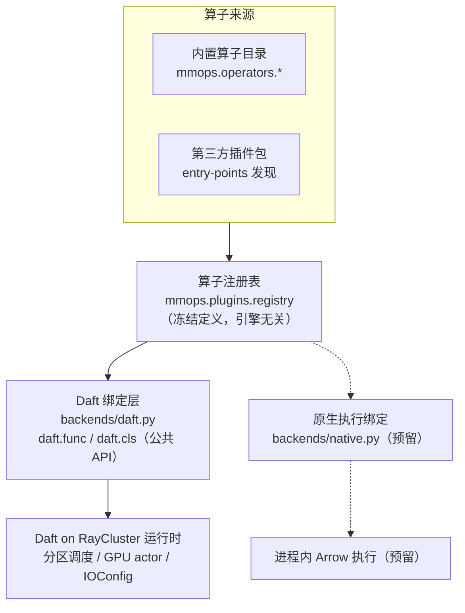

# Video Processing Module Design 视频数据处理体系模块设计

状态：设计稿（未实现）。本文描述目标架构与模块边界；对外能力承诺以 [README.md](../README.md) 为准，算子开发契约以 [operator-development.md](operator-development.md) 为准。

## 1. 背景与目标

视频处理与文本/图像的本质差异在于**负载形态**：单个文件大（数百 MB 到数 GB）、解码开销高（CPU/GPU 密集）、有效信息密度低（往往只需要少数帧）。因此视频体系必须做到：

- 数据面只搬运**引用**，不搬运字节；
- 解码延迟到 worker 端**按需**发生，且支持 S3/HDFS 等远程存储的流式 Range 读取；
- 分区级并行由执行引擎（Daft on RayCluster）负责，算子不自行并行。

本文覆盖五个模块：

| 模块           | 位置                                    | 状态               |
| ------------ | ------------------------------------- | ---------------- |
| A. 插件化算子扩展   | `src/mmops/plugins.py`                | 新增               |
| B. 视频算子目录    | `src/mmops/operators/video/`          | 新增               |
| C. 视频流转与执行模型 | 贯穿 A/B + `src/mmops/backends/daft.py` | 设计约束，少量改动        |
| D. 原生执行接缝    | `src/mmops/backends/`（预留）             | 仅保留接缝，不对外承诺      |
| E. 向量化内核层    | `src/mmops/kernels/`                  | 新增（一期库封装，二期原生扩展） |

## 2. 总体架构



关键点：注册表中流转的是**冻结的** **`OperatorDefinition`/`EntrypointDefinition`**（见 `src/mmops/_definitions.py`），编译绑定只发生在 facade 首次调用时（见 `src/mmops/_decorators.py` 的惰性 `_compile()`）。引擎绑定被隔离在 `backends/` 内，插件与算子代码对引擎零感知。

### 2.1 软件分层视图

上面的图是**编译/绑定路径**（垂直切分）；运行时职责按依赖方向读作**四层水平分层**：

| 层         | 职责                                                                     | 对应模块   | 技术栈                                                                                          | 编程语言                       |
| --------- | ---------------------------------------------------------------------- | ------ | ------------------------------------------------------------------------------------------ | ------------------------ |
| L1 引擎适配层  | 分区并行（委托 Daft 调度）、分级缓冲（限 IO/解码路径：Range 预取 → 节点本地块缓存 → 帧缓冲）、GPU actor 编排 | C 视频流转与执行模型、D 原生执行接缝 | Daft 公共 API（`daft.func`/`daft.cls`、`IOConfig`）、RayCluster 运行时（经 Daft 委托）、PyArrow 批传输 | Python                     |
| L2 视频算子层  | 元数据、完整性检测、内容分析、转换与产出                                                   | A 插件化算子扩展、B 视频算子目录 | mmops 冻结定义装饰器（`@row/@batch/@operator`）、PyArrow ABI、PyAV（`av.open` 流式解码/封装）、hashlib、setuptools entry-points 插件 | Python（业务接口仅标量/PyArrow）    |
| L3 向量化内核层 | 无状态纯函数微算子（色彩转换/缩放/统计等），NEON/SVE/Prefetch 加速                            | E 向量化内核层   | PyArrow 零拷贝（`pa.Buffer`/numpy view）+ FFmpeg swscale/libyuv/OpenCV（一期库封装）；二期 NEON/SVE intrinsics 平台 wheel + HWCAP 分发 | 一期 Python；二期 C/C++（intrinsics） |
| L4 底层依赖   | FFmpeg/PyAV/libyuv/OpenCV 等核心库                                         | 第三方核心库    | FFmpeg（libavcodec/libavformat/swscale）、libyuv、OpenCV 等原生库，经 PyAV 绑定进 Python | C/C++（PyAV 为其 Python 绑定层）    |

- 依赖方向严格单向：L2 → L3 → L4；L1 只搬运 Arrow 批与编译定义，不直接调用 L3/L4。
- 两个视图正交：垂直编译缝（冻结定义 → 惰性编译）与水平依赖分层互不耦合——接入原生执行或新引擎时只动编译缝，不动分层。
- 垂直编译缝全栈 Python：冻结定义为纯 dataclass（`src/mmops/_definitions.py`），惰性编译在 facade（`src/mmops/_decorators.py` 的 `_compile()`），引擎绑定收敛于 `src/mmops/backends/`（`daft.py` 现役 / `native.py` 预留）；跨语言边界只出现在 L4 原生库与 L3 二期原生扩展。

## 3. 模块 A：插件化算子扩展

### 3.1 设计原则

1. **注入表达式工厂，不 patch Daft。** 算子以可调用对象出现，用法是 `df.with_column("x", op(df["video"]))`，不修改 `daft.DataFrame` 或任何 Daft 内部结构，无侵入性。
2. **显式加载，无 import 副作用。** 插件只在用户显式调用 `mmops.load_plugins()` 时发现与注册；包导入本身不触发任何插件代码。
3. **冻结定义进注册表。** 注册表保存的是 `@mmops.row / batch / operator` 产出的 facade，天然 pickleable、引擎无关。

### 3.2 发现机制：setuptools entry-points

```toml
# 第三方插件包的 pyproject.toml
[project.entry-points."mmops.plugins"]
acme_video = "acme_mmops_video.plugin:register"
```

```python
# src/mmops/plugins.py（新增，唯一职责）
from mmops.plugins import load_plugins, registry

load_plugins()      # 显式触发：扫描 entry-points，逐个调用 register(registry)
registry["decode"]  # 映射：注册名 -> FunctionFacade / OperatorFacade
```

- `registry` 为进程级单例映射，键为算子注册名（建议 `域.算子` 形式避免冲突，如 `"video.decode"`）。
- 重复注册同名算子视为 `DefinitionError`。
- entry-point 目标函数签名为 `register(registry: OperatorRegistry) -> None`。

### 3.3 表达式工厂注入

插件注册的就是普通的 mmops 定义对象，与内置算子完全同构：

```python
# acme_mmops_video/plugin.py
import pyarrow as pa
from mmops import batch, operator, Resources

@batch(return_dtype=pa.struct([...]), batch_size=2)
def fast_meta(uris: pa.Array) -> pa.StructArray: ...

@operator(resources=Resources(gpus=1), max_concurrency=1)
class AcmeDecoder:
    def __init__(self, hwaccel: str = "cuda") -> None:
        ...  # 重资源仅在 __init__ 初始化

    @batch(return_dtype=pa.list_(pa.struct([...])))
    def decode(self, uris: pa.Array) -> pa.Array: ...

def register(registry):
    registry.register("video.fast_meta", fast_meta)
    registry.register("video.decode", AcmeDecoder)
```

编译仍走既有链路：facade 惰性调用 `backends/daft.py` 的 `compile_function` / `compile_operator`（内部使用公共 Daft API：`daft.func`、`daft.func.batch`、`daft.cls`）。插件作者不需要了解任何绑定细节。

### 3.4 约束

- 插件不得 import 私有 Daft API（`daft.udf.udf_v2` 等）；不得直接持有 `daft.Series`/`daft.DataType` 进业务代码。
- 注册表是唯一的跨包共享点；插件之间不得相互 import 内部模块。

## 4. 模块 B：视频算子目录

首批 10 个算子按"元数据 / 完整性检测 / 内容分析 / 转换与产出"分组，置于 `src/mmops/operators/video/`，重依赖（PyAV 等）只进 `video` extra：

| 组    | 算子                    | 执行形态                   | 职责                                        | 输出 dtype                                             |
| ---- | --------------------- | ---------------------- | ----------------------------------------- | ---------------------------------------------------- |
| 元数据  | `VideoFile_metadata`  | `@batch`（小 batch）      | 读容器头，解析 duration/resolution/codec/码率/流清单等 | `pa.struct({duration_s, width, height, codec, ...})` |
| 元数据  | `file_sha256`         | `@batch`               | 流式读取整文件计算 SHA-256 与字节数，跨副本一致性校验           | `pa.struct({sha256, size_bytes})`                    |
| 完整性  | `container_integrity` | `@batch`               | 容器结构扫描：索引完整性、流注册、可寻址性                     | `pa.struct({ok, issues: list})`                      |
| 完整性  | `stream_integrity`    | `@operator`（重解码）       | 码流校验 + 全量解码到底，统计坏帧/丢帧/解码错误位置              | `pa.struct({ok, decoded_frames, errors: list})`      |
| 完整性  | `timestamp_audit`     | `@batch`               | 包级 pts/dts 审计：单调性、跳变、重叠                   | `pa.struct({ok, gaps, jumps, ...})`                  |
| 完整性  | `av_sync`             | `@batch`（包级）           | 音视频起点偏移与播放时长漂移检测                          | `pa.struct({start_offset_s, drift_s})`               |
| 内容   | `content_anomaly`     | `@operator`（GPU actor） | 黑屏/花屏/冻结等帧级异常检测，统计走内核 `frame_stats`       | `pa.struct({frozen_ratio, black_ratio, ...})`        |
| 转换产出 | `timestamp_fix`       | `@operator`（写文件）       | 重写单调连续时间戳并 remux 落盘                       | `pa.string()`（输出 URI）                                |
| 转换产出 | `remux`               | `@operator`（写文件）       | 转封装不转码（换容器/封装格式）                          | `pa.string()`（输出 URI）                                |
| 转换产出 | `video_split`         | `@operator`（写文件）       | 按时长/关键帧分片并生成索引清单，分片以 list 折叠保 1:1         | `pa.list_(pa.struct({uri, index, start_s, end_s}))`  |

数据契约要点（与 [operator-development.md](operator-development.md) 一致）：

- **严格 1:1**：一行 = 一个文件；帧序列以 `pa.list_(pa.struct(...))` 折叠在单列内，不炸行；`video_split` 分片清单同理折叠。
- batch 进出均为 `pa.Array`/`pa.StructArray`， dtype 与行数不变；多输出列走 struct + `unnest=True`。
- 帧像素编码为 `binary`（PNG/JPEG 字节）而非裸 ndarray，保持 Arrow ABI 纯净。
- `daft.DataType.file()` 不是 PyArrow 类型，`return_dtype` 一律按 URI `string` 声明；`daft.File` 句柄只在 row 路径函数体内出现（Daft 会将 string 列物化为 `daft.File` 供函数消费）。
- **写文件算子**（`timestamp_fix`/`remux`/`video_split`）：输出字节直接写入目标存储（目标目录为 `__init__` 参数），Arrow 行内只回流输出 URI 引用；输出文件名由输入 URI + 序号/内容确定性派生，保证重跑幂等；凭证仍走 `IOConfig`（§5.3）。

状态与初始化语义：

- decoder 的硬件上下文（NVDEC/CUDA）、 codec 探测器等仅在 `__init__` 初始化，`@operator` 编译为 `daft.cls` actor 后跨分区复用。
- 所有实例状态必须可 pickle 或可重建；不允许在 `__call__` 内做一次性初始化判断之外的隐藏状态。

## 5. 模块 C：视频流转与执行模型

### 5.1 懒引用原则

DataFrame 中只存在 **URI string 列**（或 manifest 扫描产物）。视频字节在任何阶段都不进入 Arrow 记录批；`daft.File` 作为懒引用随分区调度流转，worker 端算子内按需打开（`av.open(file)` 走 HTTP Range 流式读取），不整文件落盘。


### 5.2 分区与内存预算

- 大文件场景按 **1 文件 1 分区**组织，单分区解码内存预算 ≈ `batch_size × 帧数 × 帧字节数`；重解码算子用小 `batch_size`（2–4）。
- 分区并行度完全由 Daft 执行计划决定；算子内部不做线程/进程并行，避免与调度层冲突。
- 可选节点本地块缓存（键：URI + byte-range），减少同一节点重复拉流；缓存开关作为算子 `__init__` 参数而非全局配置。

### 5.3 凭证与 IOConfig

S3/HDFS/OSS 的 endpoint、凭证统一通过 Daft `IOConfig` 构造并随执行计划下发到 worker。红线：凭证只存在于运行时配置通道，不进代码、日志、算子参数序列化与输出元数据。

### 5.4 GPU actor

重解码用 `@operator(resources=Resources(gpus=1), max_concurrency=1)` 定义；`compile_operator` 将其编译为 `daft.cls` actor，CUDA 上下文仅在 `__init__` 建立一次。`max_concurrency` 已在现有 `operator()` 签名中支持。

### 5.5 两段式流水线

```python
import daft
from mmops.operators.video import VideoFile_metadata, content_anomaly

# 阶段一：元数据扫描（纯 CPU，小 batch）
manifest = daft.read_parquet("s3://lake/videos/manifest")
meta = (
    manifest.with_column("meta", VideoFile_metadata(manifest["uri"]))
    .where(daft.col("meta")["duration_s"] > 5)  # 谓词下推，短视频直接淘汰
)

# 阶段二：重解码分析（GPU actor，懒引用按需打开）
out = meta.with_column("anomaly", content_anomaly()(meta["uri"]))
out.write_parquet("s3://lake/anomaly/")
```

`VideoFile_metadata` 先行 + 谓词下推是视频库场景最大的性能杠杆：绝大多数分区在进入 GPU 解码前即被淘汰。

## 6. 模块 D：原生执行接缝（预留，不承诺）

- 冻结定义本身引擎无关；`backends/native.py`（未来）以相同签名的 `compile_function` / `compile_operator` 消费同一批定义，实现进程内 Arrow 执行，零 Ray 调度开销。
- 唯一接缝点是 facade 的惰性编译（`_decorators.py` 中 `_compile()` 的 import 目标），按 backend 参数解析，算子与插件代码零改动。
- **对外口径**：1.x 只承诺 Daft 执行。原生 backend 在发布前仅作为内部接缝存在并保持测试覆盖，不写入 README 能力声明，不进入 extras。
- 若该接缝启动自研进程内执行内核（Rust + arrow-rs 路径）的模块设计（对比用，未实现）见 [native-kernel-design.md](native-kernel-design.md)。

## 7. 模块 E：向量化内核层

### 7.1 定位与契约

内核层是 L2 算子层下调用的**无状态纯函数**集合，置于 `src/mmops/kernels/`：

- 无 I/O、无线程、无引擎依赖：不 import `daft`/`av`，不做网络或磁盘访问，不创建线程。
- Arrow ABI 零拷贝：输入输出为 `pa.Array`/`pa.Buffer`（或 numpy view），不发生整批 Python 对象化。
- 纯函数：相同输入必得相同输出，无隐藏状态，天然可测试、可向量化。

### 7.2 内核微算子清单

| 微算子           | 签名（概念）                                             | 说明                       |
| ------------- | -------------------------------------------------- | ------------------------ |
| `yuv_to_rgb`  | `(YUV planes, width, height, layout) -> pa.Buffer` | 色彩空间转换，走 swscale/libyuv  |
| `resize`      | `(frame buffer, w, h, interpolation) -> pa.Buffer` | 缩放，NEON 路径由底层库提供         |
| `normalize`   | `(pa.Array floats, mean, std) -> pa.Array`         | 逐像素归一化，纯内存带宽型            |
| `frame_stats` | `(frame buffer) -> pa.StructArray`                 | 亮度直方图/方差等统计，完整性检测与内容分析共用 |

内核微算子是 L2 算子的加速底座（如 `frame_stats` 供 `content_anomaly`/`stream_integrity` 消费），不作为独立 API 对外承诺；用户可见的首批能力为 §4 的 10 个算子。

### 7.3 SIMD 策略

- **一期只用库**：FFmpeg swscale（自带 NEON 汇编）、libyuv、OpenCV aarch64 构建覆盖色彩转换/缩放/统计主流路径，不手写内核。
- **二期按 profiling 热点自研**：仅对一期覆盖不足的热点写 intrinsics；经 HWCAP 运行时探测分发 NEON/SVE 路径（SVE 需鲲鹏 920 代际及以上），始终保留标量回退作为 oracle。
- **交付形态**：原生扩展需平台 wheel（linux-aarch64 等）与 CI 矩阵支撑，一期不引入。

### 7.4 测试

- 标量 oracle 对拍：每个 SIMD/库路径以纯 Python 标量实现为基准，随机输入 + 边界输入（非对齐、宽高非整除、空帧）数值对拍。
- 不依赖 Daft：内核测试为纯 Arrow/pytest，运行秒级。

## 8. 依赖与打包

- `video` extra 填充前保持为空；实现时加入 `av>=12`（解码内核如需替换为 decord，在评审时定）。
- `all` 必须是 `text + image + audio + video + document + multimodal` 的扁平并集：video 落地后 `all = ["daft>=0.7", "av>=12"]`，同步更新 README 安装节与打包测试（PEP 621 extras 不能互相引用）。
- `plugins` 模块零第三方依赖，随核心包发布。
- 内核层一期为纯 Python/库封装（swscale/libyuv/OpenCV 走既有 `video` extra），零新增重依赖；二期自研原生扩展需平台 wheel 与 CI 矩阵，届时评估是否拆独立发行包。

## 9. 测试策略

沿用 [operator-development.md](operator-development.md#testing-requirements) 的测试矩阵：

1. **单元/eager**：小体量真实视频 fixture（非 mock 解码），覆盖 null/空批/短批；row 与 batch 路径一致性。
2. **内核对拍**：SIMD/库路径以标量 oracle 对拍（含非对齐/非整除/空帧边界），不依赖 Daft。
3. **真 Daft 集成**：本地文件与（以 moto 模拟的）S3 路径各一条端到端流水线；验证 1:1 行数、struct dtype、谓词下推后的分区淘汰；写文件算子（`timestamp_fix`/`remux`/`video_split`）读回输出文件校验。
4. **序列化**：facade/算子实例 pickle 往返；`__getstate__` 剥离锁与编译缓存的行为回归。
5. **打包**：extras 联动测试 + 按仓库验证清单执行 wheel 外装真 Daft 冒烟。

## 10. 落地顺序

1. `src/mmops/plugins.py`：注册表 + entry-points 加载器（含重复注册报错测试）。
2. `src/mmops/kernels/`：一期微算子（库封装 + 标量 oracle 对拍测试）。
3. `src/mmops/operators/video/`：先 `@batch` 只读算子（`VideoFile_metadata`/`file_sha256`/`container_integrity`/`timestamp_audit`/`av_sync`）打通契约，再上重解码（`stream_integrity`/`content_anomaly`，先 CPU 后 GPU），最后写文件算子（`timestamp_fix`/`remux`/`video_split`）。
4. `pyproject.toml`：填 `video` extra，联动 `all` / README / 打包测试。
5. 两段式流水线集成测试 + wheel 外装冒烟。
6. 原生接缝：仅当出现单机小数据的具体需求时实现 `backends/native.py`；自研 SIMD 内核（二期）同理按需启动。

## 11. 约束与红线

- 只用公共 Daft API（`daft.func` / `daft.cls` / `daft.method`），禁用 `udf_v2` 私有接口。
- batch 桥接只收发 `pa.Array`/`pa.StructArray`；严格 1:1；帧序列用 `pa.list_(pa.struct(...))`。
- 模型/解码器仅在算子 `__init__` 初始化；worker 绑定定义必须 pickleable。
- 凭证只走 `IOConfig` 运行时通道；不进代码、日志、序列化元数据。
- 不静默降级：Daft 版本不支持的选项显式抛 `DaftCompatibilityError`；未实现的执行引擎不对外承诺。
- 内核层不 import `daft`/`av`、不做 I/O 与线程；SIMD/库路径必须有标量 oracle 对拍测试。
- 分区并行只委托引擎调度；分级缓冲限定 IO/解码路径，不重造 shuffle/spill。

